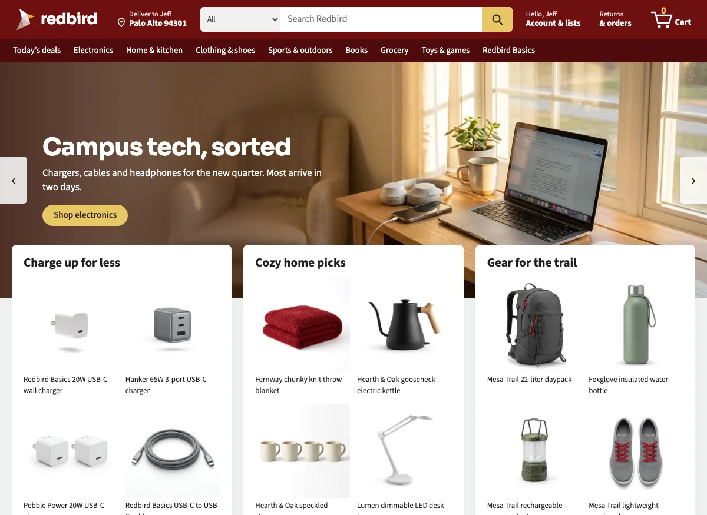

# Redbird

Redbird is a made-up online store with accessibility problems built in on purpose. We made it for the AI for Accessibility workshop, so teams can build adapters that fix a real-looking shopping site and try the verification layer on a shopping task.

Everything in the store is made up: the brands, the products, the reviews and the photos, which were made with AI. Nothing can actually be bought.

## Open it

- Online: https://ai-for-accessibility-collective.github.io/redbird/
- On your computer: download the repository, run `python3 tools/serve.py` inside the folder, and open http://localhost:8000. There is nothing to install or build.

## Planted issues

34 problems are turned on by default. For example, there are photos without alt text, color choices with no names, countdown timers, and shipping times with no date. [ISSUES.md](ISSUES.md) lists all of them, who each one affects, and whether an adapter already exists for it.

| address | what you get |
|---|---|
| `?issues=on` | all 34 (the default) |
| `?issues=off` | none, so the store works with a screen reader and a keyboard |
| `?issues=6,23` | only issues 6 and 23 |

Your choice is remembered in your browser.

## Try an adapter

Add `?try=` and an adapter's name to any page. For example, `product?id=hearth-oak-kettle&issues=6&try=swatch-names` names the kettle's color choices for a screen reader. The [workshop folder](workshop/README.md) has four example adapters, three sample profiles, and a template for writing your own.

The [AI for Accessibility extension](https://github.com/AI-for-Accessibility-Collective/AI-for-Accessibility-Extension) also works on Redbird the same way it works on any other site.

## Agent task

[AGENT-TASK.md](AGENT-TASK.md) is a shopping task for the verification layer: buy a USB-C charger under $25 that arrives by a set date. The store has six points where an agent should stop and ask the person. For example, a protection plan is already ticked, and a charger sells out at checkout.

## Other address options

| address | what it does |
|---|---|
| `?today=2026-11-02` | pretends today is November 2, so delivery dates are the same on every run. `?today=now` goes back to the real date. |
| `?reset=1` | empties the cart and the order history |

## Pages and files

| page | files |
|---|---|
| home | `index.html`, `assets/js/pages/home.js` |
| search and departments | `search.html`, `assets/js/pages/search.js` |
| product | `product.html`, `assets/js/pages/product.js` |
| cart | `cart.html`, `assets/js/pages/cart.js` |
| checkout | `checkout.html`, `assets/js/pages/checkout.js` |
| order confirmation | `order.html`, `assets/js/pages/order.js` |

The header, product cards, prices and cart are in `assets/js/store.js`. The products are in `assets/js/catalog.js`, and the styles are in `assets/css/site.css`. Each planted issue is an `if (on(N))` branch in the scripts or an `html[data-planted~="N"]` rule in the CSS, so you can search for its number.

## Make another store from this one

1. Copy the repository.
2. Change the products in `assets/js/catalog.js`. Each product has a cluttered title and a description full of jargon, plus a clean version of each, so the store works with issues on and off.
3. Add photos to `assets/img/products/` and `assets/img/gallery/`, then run `python3 tools/make-infographics.py` and `python3 tools/make-image-list.py`. The prompts we used for the AI photos are in `tools/image-prompts.tsv` and `tools/gallery-shots.tsv`.
4. Change the name and logo in `assets/js/store.js` and the colors at the top of `assets/css/site.css`.
