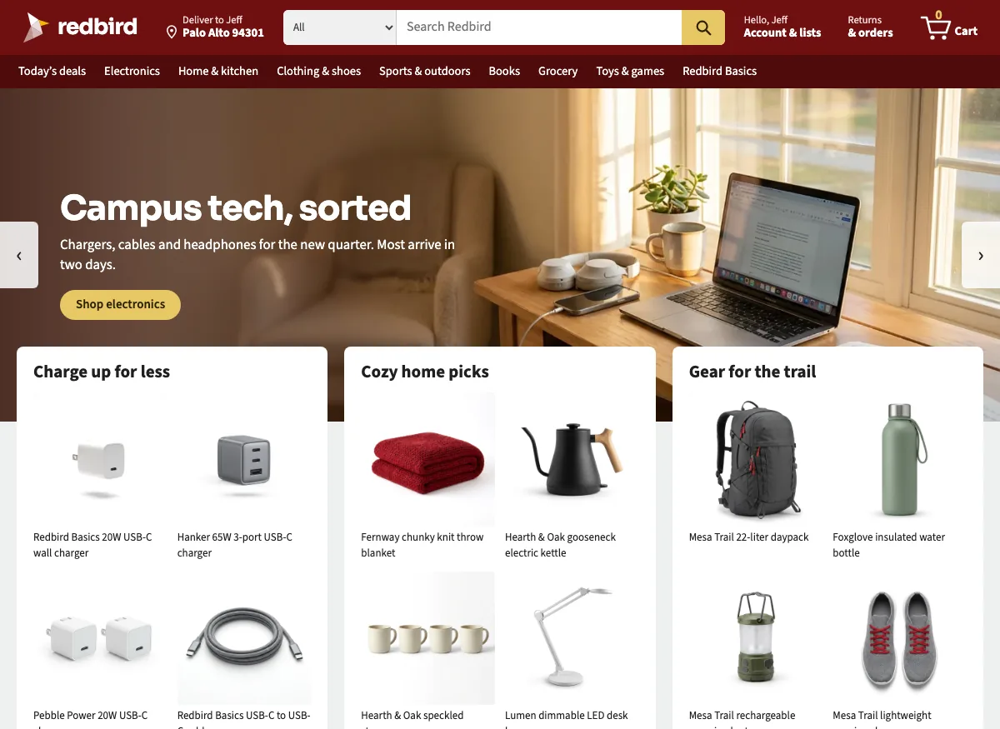

# Redbird

Redbird is a made-up online store with accessibility problems built in on purpose. We made it for the AI for Accessibility workshop, so teams can build adapters that fix a real-looking shopping site and try the verification layer on a shopping task.

Everything in the store is fake, including the brands, products, reviews and photos (generated with AI). Nothing can actually be bought.

## Open it

- Online: https://redbird-workshop.vercel.app/
- On your computer: download the repository, run `python3 tools/serve.py` inside the folder, and open http://localhost:8000. There is nothing to install or build. The AI parts work on the live site, where the store's server has the Gemini key, or while the store is connected to your toolkit.

## Planted issues

36 problems are turned on by default. For example, there are photos without alt text, color choices with no names, countdown timers, and shipping times with no date. [ISSUES.md](ISSUES.md) lists all of them, who each one affects, and which adaptation fixes it, if any.

| address | what you get |
|---|---|
| `?issues=on` | all 36 (the default) |
| `?issues=off` | none, so the store works with a screen reader and a keyboard |
| `?issues=6,24` | only issues 6 and 24 |

Your choice is remembered in your browser.

## Try an adapter

Add `?try=` and an adaptation's name to any page. For example, `product?id=hearth-oak-kettle&issues=6&try=swatch-names` names the kettle's color choices for a screen reader. The [workshop folder](workshop/README.md) has Redbird's own adaptations, four sample profiles, and a template. To go through them step by step, start with the [workshop guides](https://redbird-workshop.vercel.app/workshop/).

Fixes are built with the [AI for Accessibility toolkit](https://github.com/AI-for-Accessibility-Collective/AI-for-Accessibility-Toolkit): in its browser extension's Builder, or in code with a coding agent and the toolkit's skill. They run in your own Chrome through the extension, on the store and on any other site. The toolkit is an active research project, pre-alpha, a technology probe: its adapters are unvalidated, and it is not a replacement for assistive technology. In practice, a fix can change a page in ways nobody has checked with the people it is meant for.

## Connect to your toolkit

Sign in to your toolkit's developer console, go to Apps, press **+ Connect an app**, and press Open Redbird with the store's address. The store opens connected to your account:

- Each Redbird tab shows up in the console under Apps, as Redbird demo. From there you can turn Redbird's adaptations on and off, and so can a coding agent that has your token.
- You can shop as your own toolkit profile ("Your toolkit profile" in the panel's Profiles tab), and the store's own needs, like real delivery dates, are suggested in the extension's Profile tab.

The toolkit has to allow the store's address, so start a local one with `npm run dev:workshop`. To connect by hand instead, open the panel's Profiles tab, then Connect to your toolkit, and paste the toolkit's address and your default token.

## Agent task

[AGENT-TASK.md](AGENT-TASK.md) is a shopping task for the verification layer: buy a USB-C charger under $25 that arrives by a set date. The store has six decision points where the agent should stop and ask the user. For example, a protection plan is already ticked, and a charger sells out at checkout.

## Other address options

| address | what it does |
|---|---|
| `?today=2026-11-02` | pretends today is November 2, so delivery dates are the same on every run. `?today=now` goes back to the real date. |
| `?reset=1` | empties the cart and the order history |

## Pages and files

| page | files |
|---|---|
| home | `index.html`, `assets/js/pages/home.js` |
| search and departments | `search.html`, `assets/js/pages/search.js` |
| product | `product.html`, `assets/js/pages/product.js` |
| cart | `cart.html`, `assets/js/pages/cart.js` |
| checkout | `checkout.html`, `assets/js/pages/checkout.js` |
| order confirmation | `order.html`, `assets/js/pages/order.js` |

The header, product cards, prices and cart are in `assets/js/store.js`. The products are in `assets/js/catalog.js`, and the styles are in `assets/css/site.css`. Each planted issue is an `if (on(N))` branch in the scripts or an `html[data-planted~="N"]` rule in the CSS, so you can search for its number.

## Make another store from this one

1. Copy the repository.
2. Change the products in `assets/js/catalog.js`. Each product has a cluttered title and a description full of jargon, plus a clean version of each, so the store works with issues on and off.
3. Add photos to `assets/img/products/` and `assets/img/gallery/`, then run `python3 tools/make-image-list.py`. The prompts we used for the AI photos are in `tools/image-prompts.tsv` and `tools/gallery-shots.tsv`.
4. Change the name and logo in `assets/js/store.js` and the colors at the top of `assets/css/site.css`.
